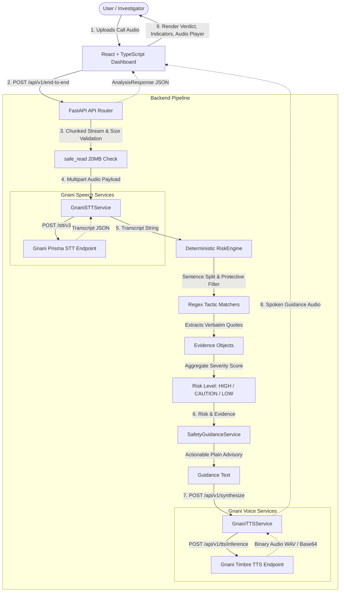

# VoiceShield AI — Technical Architecture

This document describes the engineering architecture, data flow, component design, and integration contracts of **VoiceShield AI: Multilingual Voice Scam Intelligence and Prevention System**.

---

## 1. High-Level Architecture Diagram



---

## 2. Component Breakdown

### A. FastAPI API Router (`backend/app/api/routes.py`)
- **`POST /api/v1/end-to-end`**: Orchestrates complete upload-to-analysis workflow.
- **`POST /api/v1/transcribe`**: Dedicated endpoint for standalone transcription.
- **`POST /api/v1/analyze`**: Direct text analysis endpoint with input validation (rejects blank transcripts with HTTP 400).
- **`POST /api/v1/synthesize`**: Text-to-speech generation endpoint (rejects blank text with HTTP 400).
- **`GET /health`**: Health check reporting server status and semantic version.
- **`safe_read()`**: Memory-safe streaming function that reads uploads in 1MB chunks to enforce the 20MB ceiling before allocating full memory.

### B. Gnani Prisma STT Service (`backend/app/services/gnani_stt.py`)
- Interfaces with Gnani's Speech-to-Text REST API (`https://api.vachana.ai/stt/v3`).
- **Payload:** Multipart form data containing `audio_file`, `language_code` (`hi-IN`, `en-IN`, or `indic-auto`), and `format="transcribe"`.
- **Authentication:** `X-API-Key-ID` header.
- **Demo Mode:** When `GNANI_API_KEY` is not present, returns an explicit demo transcript marked with `[DEMO MODE]` flag (`is_demo=True`).
- **Fault Tolerance:** Robust validation catching missing fields, empty transcript strings, HTTP errors, and timeouts (30-second ceiling).

### C. Explainable Risk Engine (`backend/app/services/risk_engine.py`)
- Analyzes transcripts deterministically using multilingual regular expressions and contextual sentence filters.
- **Supported Dialects:** English, Hindi (Devanagari), and Hinglish (Latin script code-switching).
- **Scam Typologies Covered:**
  1. `OTP_REQUEST` (HIGH): Explicit requests for one-time passwords, verification codes, PINs, or security codes.
  2. `PAYMENT_PRESSURE` (HIGH): Threats of immediate bank account deactivation, utility disconnection, or coercive fund transfers.
  3. `IMPERSONATION` (MEDIUM): Claims of official authority from police departments, CBI, customs, or RBI.
  4. `REMOTE_ACCESS` (HIGH): Instructions to install screen-sharing software (AnyDesk, TeamViewer, QuickSupport).
- **Protective & Educational Context Filtering:** Sentences matching safety advice (e.g., *"Never share your OTP"*, *"Do not install AnyDesk"*, *"Scammers impersonate police"*) are identified and skipped to prevent false alarms.
- **Verbatim Evidence Attribution:** Preserves the exact sentence quote (`excerpt`) alongside the severity rating and explanatory rationale.

### D. Safety Guidance Service (`backend/app/services/safety_guidance.py`)
- Maps detected indicators and risk levels into concise, actionable instructions.
- Guides users on immediate protective measures (disconnecting call, reporting to cybercrime portal, contacting official bank helplines).

### E. Gnani Timbre TTS Service (`backend/app/services/gnani_tts.py`)
- Interfaces with Gnani's Text-to-Speech REST inference API (`https://api.vachana.ai/api/v1/tts/inference`).
- **Payload:** JSON with model `timbre-v2.5`, voice `Nalini`, Indic language code, and linear PCM WAV audio configuration (16kHz, mono).
- **Demo Mode Handling:** Explicitly blocks synthesis in Demo Mode with HTTP 400 explaining that credentials are required, preventing fake silent audio.

### F. Frontend Dashboard (`frontend/src/App.tsx`)
- Single-page interface built with React 18, TypeScript, and Tailwind CSS.
- Features:
  - Ephemeral drag-and-drop audio uploader with 20MB client-side validation.
  - Indic language selector (`indic-auto`, `hi-IN`, `en-IN`).
  - Prominent **Demo Mode Active** / **Live Provider Mode** status indicator.
  - Interactive audio playback for safety guidance.
  - One-click transcript clipboard copy and structured JSON report export.

---

## 3. Data Contracts & Schemas

### `Evidence` Schema
```json
{
  "excerpt": "Please disclose your verification code to verify your account.",
  "rationale": "Explicit request to disclose a one-time password (OTP), PIN, or verification code.",
  "severity": "HIGH",
  "indicator_type": "OTP_REQUEST"
}
```

### `AnalysisResponse` Schema
```json
{
  "risk_level": "HIGH",
  "summary": "Transcribed Text: '...'",
  "indicators": [ /* Array of Evidence objects */ ],
  "guidance": "Warning. High-risk indicators detected. Never share your OTP...",
  "limitations": "Advisory analysis based on pattern matching. Does not definitively authenticate callers or prove fraud.",
  "is_demo": false
}
```

---

## 4. Security & Privacy Guarantees

1. **Zero Disk Retention:** Audio uploads are consumed in-memory and never written to disk, cache files, or databases.
2. **Sanitized Logs:** Transcripts, raw audio buffers, and API keys are strictly excluded from console logs and error traces.
3. **Memory Exhaustion Defense:** Uploads exceeding 20MB are rejected immediately via chunked reading with HTTP 413.
4. **Credential Isolation:** API keys remain strictly server-side; the frontend bundle contains zero secrets.
