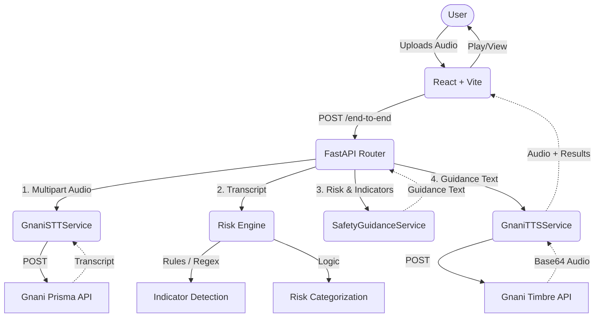

# Architecture

## Modules
1. **API Router**: Handles HTTP requests, validation, file size limits.
2. **GnaniSTTService**: Asynchronous HTTPX client for `api.vachana.ai/stt/v3`.
3. **RiskEngine**: Evaluates text against scam topologies (OTP requests, urgency).
4. **SafetyGuidanceService**: Generates context-specific warnings based on risk.
5. **GnaniTTSService**: Synthesizes warnings using `api.vachana.ai/api/v1/tts/inference`.
